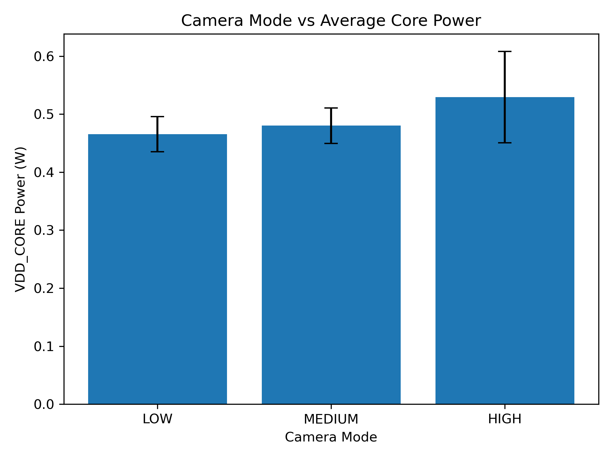
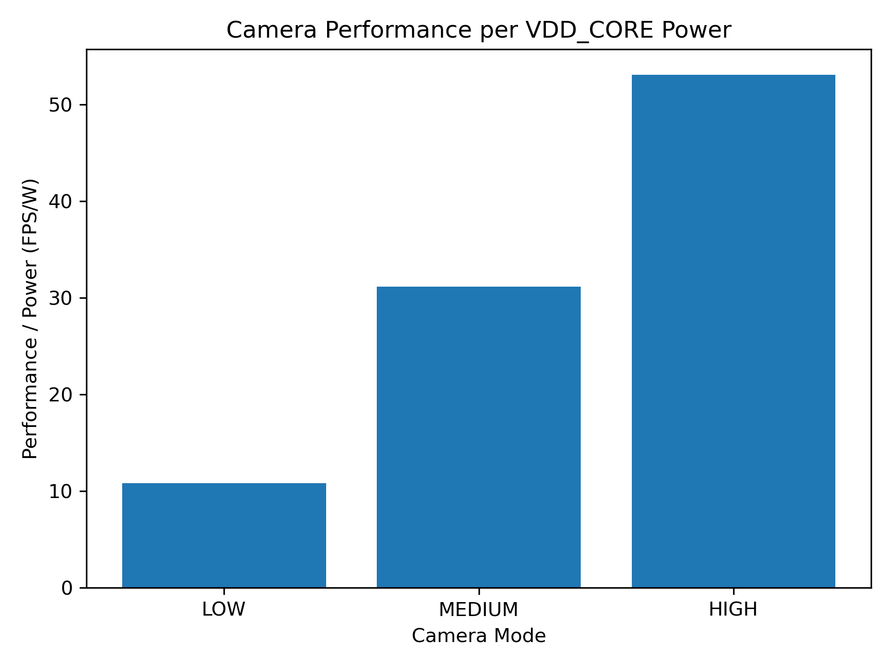

# Power-Aware Embedded Vision System

A Raspberry Pi 5 based embedded system for **runtime workload control, power monitoring, and performance analysis**.

The Raspberry Pi Camera Module 3 is used as a configurable workload. The system monitors CPU and camera performance, reads power information directly from the Raspberry Pi 5 PMIC, and dynamically adjusts the camera operating mode.

The main engineering goal is to investigate and control the relationship between:

```text
Performance ↔ Power ↔ Temperature
```

---

## Key Features

* Raspberry Pi Camera Module 3 integration
* configurable LOW / MEDIUM / HIGH camera workloads
* adaptive camera mode control
* real-time CPU temperature and usage monitoring
* Linux system load monitoring
* actual camera FPS measurement
* Raspberry Pi 5 PMIC voltage/current monitoring
* VDD_CORE rail power calculation
* real-time camera and system overlay
* CSV measurement logging
* automated fixed-mode power experiments
* repeated measurements and statistical analysis
* automatic performance/power visualization

---

## Camera Workload

Three camera modes provide different workload and performance levels.

| Mode   |  Resolution | Target FPS |
| ------ | ----------: | ---------: |
| LOW    |   640 × 480 |      5 FPS |
| MEDIUM |  1280 × 720 |     15 FPS |
| HIGH   | 1920 × 1080 |     30 FPS |

These operating modes allow the controller to trade camera performance against system resource usage.

---

## System Architecture

```text
Camera + CPU + PMIC
        |
        v
   Monitoring
        |
        v
   Controller
        |
        v
 LOW / MEDIUM / HIGH
```

The system is designed as a feedback-oriented embedded application rather than a fixed camera pipeline.

---

## PMIC Power Monitoring

The Raspberry Pi 5 PMIC is used to measure the `VDD_CORE` rail.

```text
VDD_CORE_V → Voltage
VDD_CORE_A → Current
```

Core rail power is calculated using:

```text
P = V × I
```

The following values are monitored and logged together:

* CPU temperature
* CPU usage
* system load
* camera mode
* actual FPS
* VDD_CORE voltage
* VDD_CORE current
* VDD_CORE power

Example runtime output:

```text
Camera Mode: HIGH
Camera FPS: 28.1
CPU Temperature: 53.0 C
CPU Usage: 2.5 %
Core Voltage: 0.772 V
Core Current: 0.683 A
Core Power: 0.529 W
```

> **Note:** The measured power represents the Raspberry Pi 5 **VDD_CORE rail**, not total Raspberry Pi input power.

---

## Experimental Evaluation

To quantify the performance-power relationship, the adaptive controller was disabled during testing and each camera mode was operated under fixed conditions.

Experimental procedure:

* 5 s camera warm-up
* 60 s measurement per mode
* LOW / MEDIUM / HIGH fixed operating modes
* 3 independent experimental runs
* mean and standard deviation calculation

### Results

| Mode   | Avg FPS |     CPU Usage | CPU Temperature |  VDD_CORE Power | Performance / Power |
| ------ | ------: | ------------: | --------------: | --------------: | ------------------: |
| LOW    |    5.03 | 1.58 ± 0.12 % | 52.35 ± 0.60 °C | 0.465 ± 0.030 W |         10.81 FPS/W |
| MEDIUM |   14.95 | 1.92 ± 0.05 % | 51.74 ± 0.20 °C | 0.480 ± 0.030 W |         31.15 FPS/W |
| HIGH   |   28.08 | 2.54 ± 0.11 % | 52.98 ± 0.45 °C | 0.529 ± 0.079 W |         53.05 FPS/W |

Increasing the workload from LOW to HIGH increased measured camera throughput from **5.03 FPS to 28.08 FPS**, while average VDD_CORE power increased from **0.465 W to 0.529 W**.

The HIGH mode also showed the largest power variation.

This demonstrates why real-time power feedback can be more useful than assigning a fixed assumed power consumption to each operating mode.

---

## Performance vs Power

### VDD_CORE Power



### Performance per VDD_CORE Power



Additional FPS and CPU usage plots are available in the `results/` directory.

One interesting result is that reducing workload does not automatically maximize measured performance per VDD_CORE watt.

This motivates a controller that considers **delivered performance as well as power consumption**, instead of simply selecting the lowest workload.

---

## Software Structure

```text
src/
|
|-- main.py
|   `-- Runtime orchestration
|
|-- camera.py
|   `-- Camera configuration and frame capture
|
|-- monitor.py
|   `-- CPU temperature, usage and system load
|
|-- controller.py
|   `-- Adaptive camera workload control
|
|-- power.py
|   `-- PMIC measurement and power calculation
|
|-- logger.py
|   `-- CSV measurement logging
|
|-- power_test.py
|   `-- Controlled power experiments
|
`-- analyze_power.py
    `-- Statistical analysis and visualization
```

The software is separated into monitoring, workload generation, control, logging, power measurement and analysis modules so that each component can be modified independently.

---

## Engineering Focus

This project is focused on embedded system behaviour rather than only camera functionality.

Key engineering topics include:

* embedded Linux monitoring
* workload management
* PMIC-based electrical measurements
* power-performance trade-offs
* runtime feedback and adaptation
* measurement variability
* controlled experiments
* statistical evaluation
* modular embedded software design

The system is being extended toward a controller that coordinates camera workload and active cooling based on real-time power and temperature measurements:

```text
Performance ↔ Power ↔ Temperature
```
